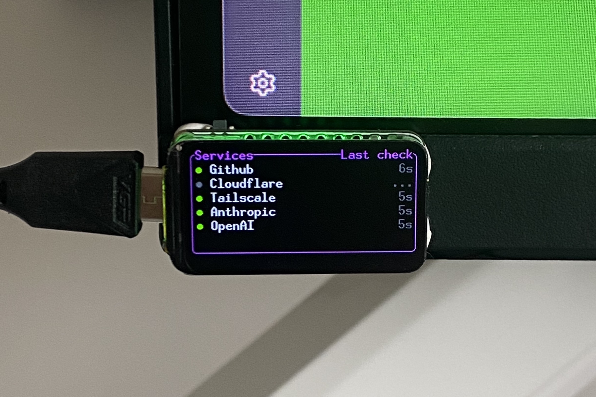
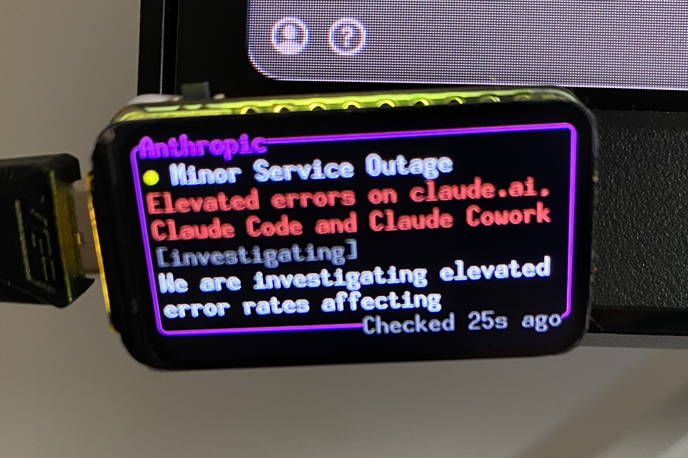
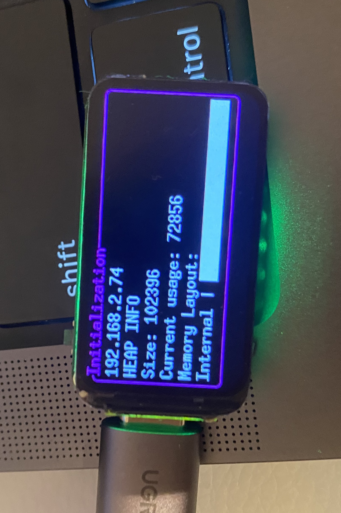
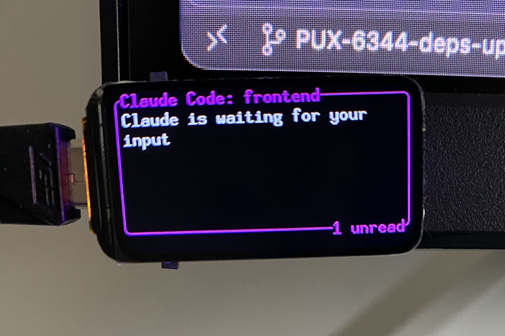

# esp-noti

Desk status monitor on an ESP32-C6. Polls service status pages and receives notifications.



## Features

- Monitors GitHub, Cloudflare, Tailscale, Anthropic and OpenAI status pages every 30s.
- Cycles between overview and per-service detail pages every 5s.
- RGB LED reflects worst severity: green, yellow, orange, red.
- `POST /notify` shows a notification and turns the LED magenta.
- Button: next page, or dismiss notification.



## Hardware

[Waveshare ESP32-C6-LCD-1.47](https://docs.waveshare.com/ESP32-C6-LCD-1.47)



## Build & flash

Requires [espflash](https://github.com/esp-rs/espflash).

```sh
WIFI_SSID=<ssid> WIFI_PWD=<password> cargo run --release
```

## Notifications



```sh
curl -X POST http://<device-ip>/notify \
  -H 'Content-Type: application/json' \
  -d '{"title": "Claude Code: frontend", "content": "Claude is waiting for your input"}'
```

`GET /health` returns status and heap usage.

## Resources

Below some useful links I used. It was my first eps32 project and I haven't done any embedded since the university.

- https://embedded.fm/blog/ese101 Really good series. The examples are in C but the knowledges are transferable.
- https://esp32.implrust.com/ 
- https://docs.espressif.com/projects/rust/book/

